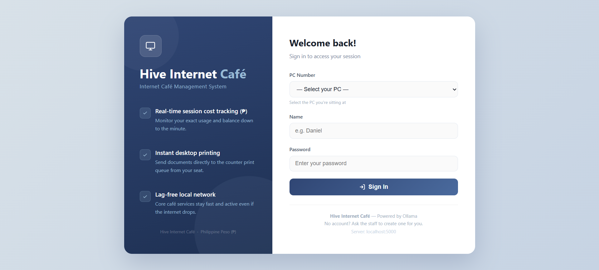
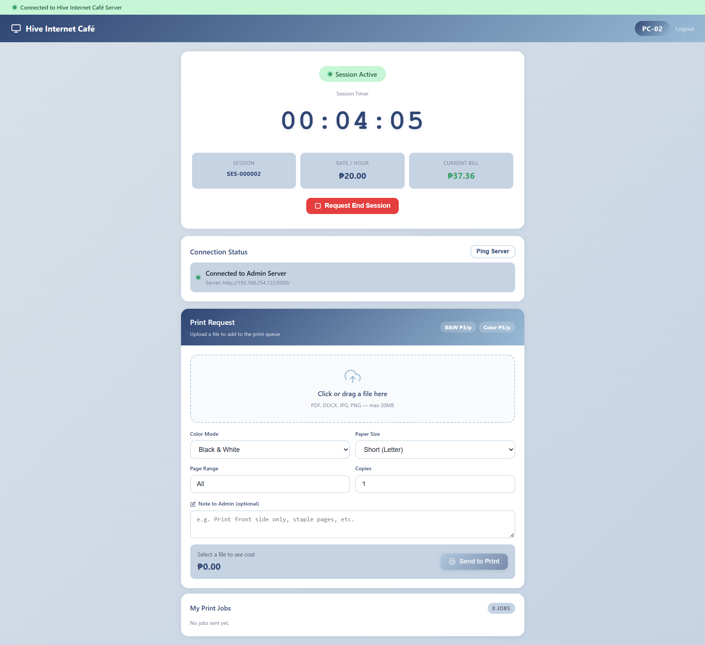
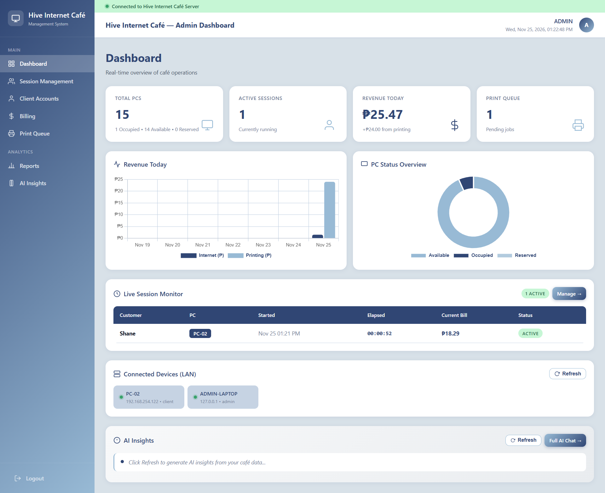
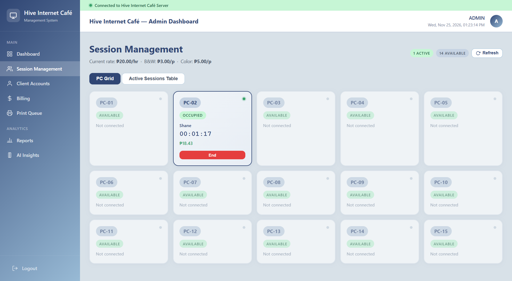
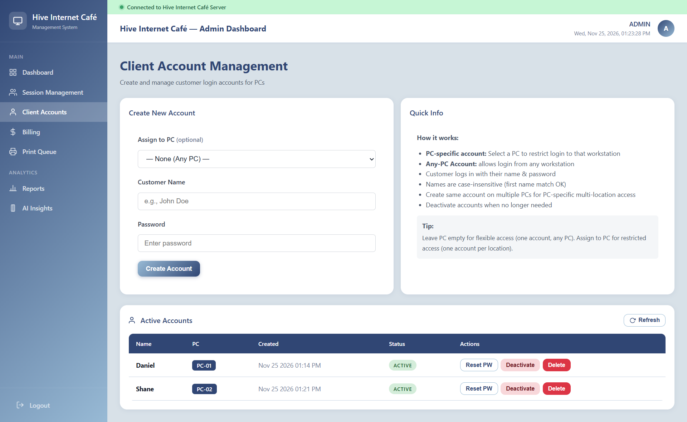
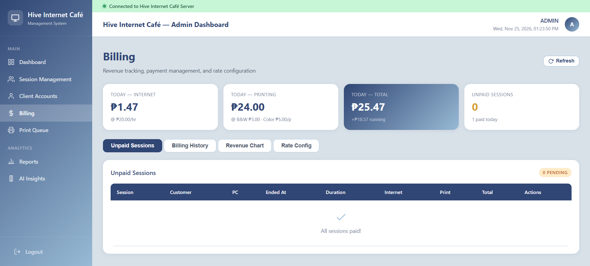
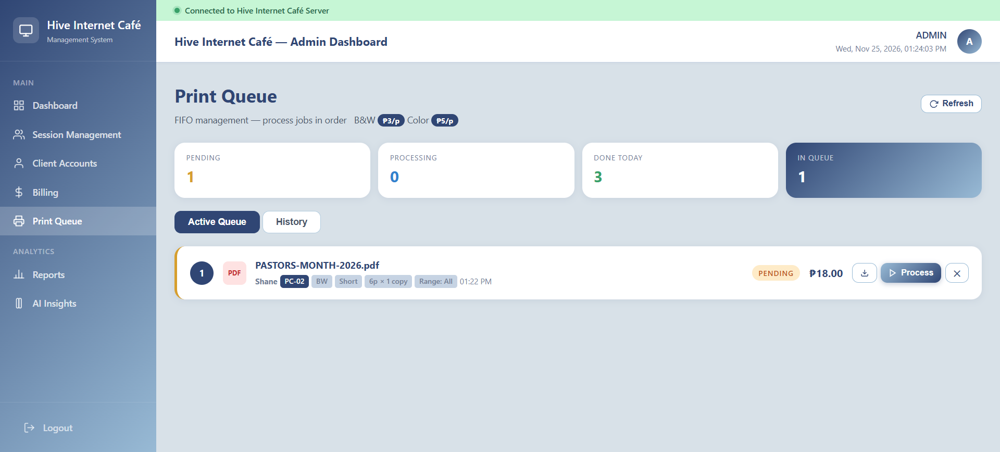
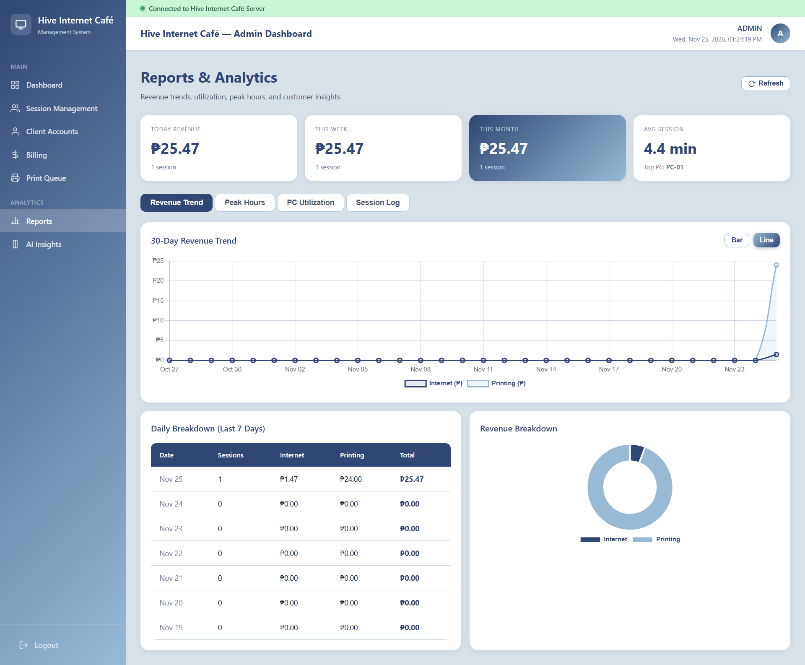
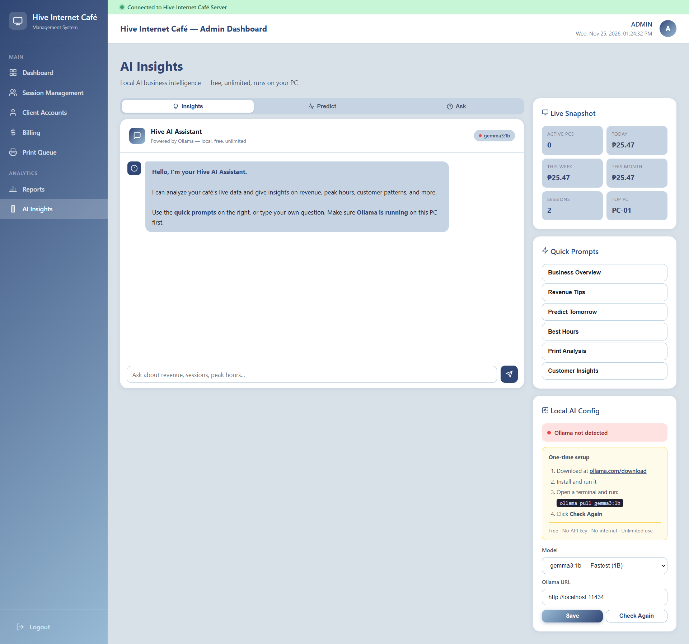

# Hive Net Café — Internet Café Management System

**A LAN-based Internet Café Management System built with Python, Flask, SQLite, and Flask-SocketIO.** Hive Net Café helps administrators manage workstations, customer accounts, internet sessions, billing, print requests, and business reports through a centralized web dashboard.

> **Portfolio project:** This repository contains the application source code and screenshots from a running instance. It is intended for local development and demonstration, not direct public production deployment. Billing is displayed in Philippine Peso (₱).

## Overview

Hive Net Café (ICMS-ASI) uses a client-server workflow. The Flask application runs on a host computer, while administrators and customers can access the system through a web browser on the same local network.

The system combines workstation and session monitoring, customer account management, internet usage billing, print-job processing, operational reports, and an optional AI-assisted insights module powered by a local Ollama service.

## Features

### Administrator dashboard and workstation management
- View the café's workstation status and connected client activity.
- Monitor 15 seeded PC workstations from the session-management interface.
- Start, extend, and end customer internet sessions.
- Receive live updates through Flask-SocketIO.

### Customer account management
- Create customer accounts assigned to a specific PC or usable from any PC.
- Reset customer passwords and deactivate, reactivate, or delete accounts.
- Use a shared login page that identifies administrator and customer accounts.

### Customer portal
- Sign in using a customer account and selected workstation.
- View the active internet session and session timer.
- Submit supported files for printing.
- Request that the administrator end the current session.

### Billing and print management
- Calculate internet usage charges using the configured hourly rate.
- Configure black-and-white and color printing rates.
- Track print jobs, including file, page range, copies, paper size, and color mode.
- Process, complete, or cancel print jobs.
- Track paid and unpaid sessions; paid sessions are included in revenue figures.

### Reports and AI-assisted insights
- Review revenue and operational summaries.
- View revenue trends, peak usage hours, workstation utilization, and top customers.
- Ask for business insights and predictions using a locally running Ollama model (optional).

### Real-time communication
- Uses Flask-SocketIO to send workstation, session, and rate updates to connected pages.
- Restores a customer's active session information after a page refresh.

## Screenshots

The following screenshots were captured from the running Hive Net Café application. They show the customer-facing pages and the main administrator modules.

### Login page

The shared sign-in page for administrators and customers, including workstation selection and account credentials.



### Customer portal — Active session and print request

The customer-facing page displays the active session timer and provides a form for submitting print jobs.



### Administrator dashboard

The administrator overview presents workstation and session summaries, revenue information, charts, and connected-client activity.



### Session management — Workstation monitoring

The session-management page displays the workstation grid, with each PC's current availability or session status.



### Client account management

Administrators can create accounts, choose PC-specific or any-PC access, and manage existing customer accounts.



### Billing and payment management

The billing page presents revenue summaries and provides access to unpaid sessions, billing history, revenue charts, and rate configuration.



### Print queue management

The print queue shows submitted jobs and their processing status, with controls for handling each request.



### Reports and analytics

The reports page displays business indicators, revenue trends, daily breakdowns, and customer or workstation statistics.



### AI insights assistant

The AI Insights page provides an interface for asking questions about café operations using the optional local Ollama integration.



## Tech Stack

| Area | Technologies |
|---|---|
| Backend | Python, Flask |
| Real-time communication | Flask-SocketIO, Socket.IO |
| Database / ORM | SQLite, Flask-SQLAlchemy |
| Authentication | Flask-Login, Werkzeug password hashing |
| Frontend | HTML, CSS, JavaScript |
| Charts | Chart.js |
| Document and image handling | PyPDF2, pdfplumber, python-docx, Pillow |
| Local AI integration | Ollama |

## Project Structure

```text
Hive-Internet-Cafe-main/
├── app.py                    # Main Flask application and Socket.IO events
├── migrate_pc_optional.py    # Database migration helper
├── requirements.txt          # Python dependencies
├── .env.example              # Environment variable template
├── setup.bat                 # Windows setup helper
├── setup.sh                  # macOS/Linux setup helper
├── models/
│   ├── database.py
│   ├── user.py
│   ├── client_account.py
│   ├── pc.py
│   ├── session.py
│   ├── print_job.py
│   └── settings.py
├── static/
│   ├── css/
│   └── js/
├── templates/
│   ├── login.html
│   ├── admin/
│   └── client/
└── docs/
    └── screenshots/          # Application screenshots used in this README
```

Runtime data directories such as `instance/` and `uploads/` are created by the application when needed. They may contain local database records or customer files and should not be committed to a public repository.

## Getting Started

### Requirements

- Python 3.10 or newer
- pip
- (Optional) [Ollama](https://ollama.com/) for AI-assisted insights

### 1. Clone the repository

```bash
git clone https://github.com/<your-username>/<your-repository>.git
cd <your-repository>
```

Run the commands below from the project root folder—the folder containing `app.py` and `requirements.txt`.

### 2. Create and activate a virtual environment

**Windows PowerShell:**

```powershell
python -m venv venv
Set-ExecutionPolicy -Scope Process -ExecutionPolicy Bypass
.\venv\Scripts\Activate.ps1
```

The execution-policy command applies only to the current PowerShell process. If you prefer not to activate through PowerShell, use Command Prompt instead:

**Windows Command Prompt:**

```bat
python -m venv venv
venv\Scripts\activate
```

**macOS / Linux:**

```bash
python3 -m venv venv
source venv/bin/activate
```

### 3. Install dependencies

```bash
python -m pip install -r requirements.txt
```

### 4. Configure environment variables

Copy `.env.example` to `.env` and replace the example `SECRET_KEY` with a unique, randomly generated value. The default host and port are `0.0.0.0` and `5000`.

**Windows:**

```bat
copy .env.example .env
```

**macOS / Linux:**

```bash
cp .env.example .env
```

Do not commit `.env` or real credentials to GitHub.

### 5. Run the application

```bash
python app.py
```

Open the application on the computer running the server:

```text
http://localhost:5000
```

To access it from another device on the same local network, use the server computer's local IP address:

```text
http://<server-lan-ip>:5000
```

On Windows, run `ipconfig` and look for the server computer's IPv4 address. Ensure the host computer's firewall permits incoming connections on TCP port `5000`.

On first run, the application initializes its SQLite database, creates the default administrator account, and seeds 15 workstation records.

## Demo Login

The application creates a default administrator account during first-time database initialization:

| Field | Demo value |
|---|---|
| Username | `admin` |
| Password | `admin123` |

**Security note:** These are development/demo credentials. Change the default password before using the application with real users or data. Set a strong `SECRET_KEY`, keep `.env` private, and do not expose the Flask development server directly to the public internet.

Customer accounts are created by an administrator from the **Client Accounts** section.

## Optional: Enable AI Insights with Ollama

The AI Insights module uses an Ollama service running locally or at a configured URL. AI functionality is optional; the core café management features do not require Ollama.

1. Install [Ollama](https://ollama.com/download).
2. Open a terminal and download a model, for example:

   ```bash
   ollama pull gemma3:1b
   ```

3. Make sure Ollama is running.
4. Open the application's **AI Insights** page. The default local Ollama URL is `http://localhost:11434`, and the default model is `gemma3:1b`.

## Supported Print Uploads

The application accepts the following file types for print requests:

- PDF (`.pdf`)
- Word documents (`.docx`)
- JPEG images (`.jpg`, `.jpeg`)
- PNG images (`.png`)

The configured upload size limit is 20 MB. Print pricing is based on the selected print options and the rates configured in the application.

## Notes and Limitations

- The application currently uses SQLite for its local setup.
- Real-time communication uses Flask-SocketIO in threading mode.
- The included run configuration uses Flask's development server and debug mode. It is intended for development and demonstration, not production hosting.
- AI insights require a separately installed and running Ollama service.
- No hosted demo or production deployment configuration is included.

## What This Project Demonstrates

- Building a multi-page web application with Flask.
- Designing database models and CRUD workflows with SQLAlchemy.
- Implementing authentication and role-aware access.
- Creating real-time client-server updates with WebSockets.
- Handling file uploads and print-job workflows.
- Calculating session charges and generating operational reports.
- Integrating an optional local AI service.

## License

No license file is currently included. Unless a license is added to this repository, all rights remain with the copyright holder and reuse is not automatically granted.
